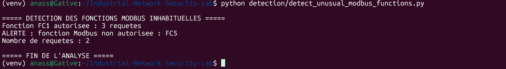
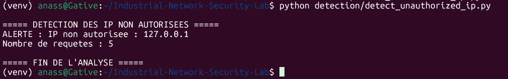
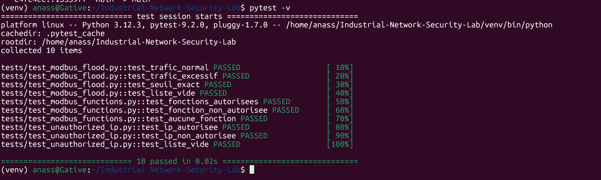

# Industrial Network Security Lab

## Project Overview

This project is an isolated laboratory designed to explore industrial network security through PLC simulation, Modbus TCP traffic analysis, and basic anomaly detection.

The laboratory uses OpenPLC Runtime to simulate an industrial controller. Network traffic is captured and analyzed to identify potentially suspicious communication patterns.

## Installation and Execution

### Prerequisites

The following tools are required:

- Ubuntu 24.04 or compatible Linux environment.
- Python 3 and pip.
- Docker Desktop with WSL2 integration, or a compatible Docker Engine.
- TShark for network traffic analysis.

### 1. Clone the Repository

```bash
git clone https://github.com/Imernissen/Industrial-Network-Security-Lab.git
cd Industrial-Network-Security-Lab
```

### 2. Set Up the Python Environment

```bash
python3 -m venv venv
source venv/bin/activate
pip install -r requirements.txt
```

### 3. Start the OpenPLC Runtime

```bash
docker compose -f plc-simulation/docker-compose.yml up -d
```

Check the container status:

```bash
docker ps
```

### 4. Generate and Capture Live Modbus Traffic

Generate 10 Modbus TCP Read Coils requests using the Python client:

```bash
python traffic-analysis/generate_modbus_traffic.py
```

To capture live Modbus traffic, start TShark in a separate terminal:

```bash
tshark -i lo -f "tcp port 502" -w traffic-analysis/modbus_live_capture.pcap
```

While the capture is running, execute the traffic generation script in another terminal. Stop TShark with `Ctrl+C` after the requests have been sent.

Analyze the captured traffic:

```bash
python traffic-analysis/analyze_modbus.py traffic-analysis/modbus_live_capture.pcap
```

The repository also includes a sample capture: `traffic-analysis/modbus_live_capture.pcap`.


### 5. Run the Detection Scripts

Run the detection scripts using the default sample PCAP file:

```bash
python detection/detect_unauthorized_ip.py
python detection/detect_unusual_modbus_functions.py
python detection/detect_modbus_flood.py
python traffic-analysis/analyze_modbus.py
```

All three detection scripts and the general traffic analysis script support specifying a different PCAP file as a command-line argument.

To analyze the live traffic capture:

```bash
python detection/detect_unauthorized_ip.py traffic-analysis/modbus_live_capture.pcap
python detection/detect_unusual_modbus_functions.py traffic-analysis/modbus_live_capture.pcap
python detection/detect_modbus_flood.py traffic-analysis/modbus_live_capture.pcap
python traffic-analysis/analyze_modbus.py traffic-analysis/modbus_live_capture.pcap
```


### 6. Run Automated Tests

```bash
pytest -v
```

### 7. Stop the OpenPLC Runtime

```bash
docker compose -f plc-simulation/docker-compose.yml down
```

## Objectives

- Simulate an industrial environment using OpenPLC Runtime.
- Understand and analyze Modbus TCP communications.
- Capture and inspect network traffic.
- Implement basic detection mechanisms for suspicious Modbus activity.
- Validate detection logic using automated tests.

## Laboratory Architecture

The laboratory is based on the following components:

- **OpenPLC Runtime:** PLC simulation.
- **Modbus TCP:** Industrial communication protocol using TCP port 502.
- **TShark / Wireshark:** Network traffic capture and analysis.
- **Python:** Implementation of detection scripts.
- **Pytest:** Automated testing of detection logic.
- **Docker:** Deployment of the OpenPLC Runtime.

The network architecture is documented in [`architecture/network_architecture.md`](architecture/network_architecture.md).

## Detection Mechanisms

Three detection mechanisms and one traffic analysis tool have been implemented:

### 1. Unauthorized IP Detection

Identifies Modbus requests originating from IP addresses that are not included in the configured allowlist.

Script: [`detect_unauthorized_ip.py`](detection/detect_unauthorized_ip.py)

### 2. Unusual Modbus Function Detection

Checks Modbus function codes against a predefined list of authorized functions.

Script: [`detect_unusual_modbus_functions.py`](detection/detect_unusual_modbus_functions.py)

### 3. Excessive Modbus Traffic Detection

Uses a sliding time window to identify unusually frequent Modbus requests.

Script: [`detect_modbus_flood.py`](detection/detect_modbus_flood.py)

### 4. General Modbus Traffic Analysis

Analyzes Modbus TCP traffic to summarize request counts, function codes, and source IP addresses, while applying basic detection rules.

Script: [`analyze_modbus.py`](traffic-analysis/analyze_modbus.py)

### Detection Examples

The following screenshots illustrate controlled detection tests.

**Unauthorized Modbus Function**



**Excessive Modbus Traffic**


**Unauthorized IP**


## Automated Testing

Automated tests are implemented with Pytest to validate the detection logic.

**Current test results:**
- 10 tests executed.
- 10 tests passed.
- 0 tests failed.

The tests cover normal traffic, suspicious activity, and boundary conditions.
### Test Execution Results


## Reports and Documentation

Technical reports are available in the [`reports/`](reports/) directory.

They document:
- Unauthorized IP detection.
- Unusual Modbus function detection.
- Excessive Modbus traffic detection.
- Automated test validation.

## Limitations and Future Improvements

The current laboratory has several limitations:

- The PLC is simulated; no physical industrial equipment is used.
- Traffic analysis is performed offline using PCAP files.
- Detection thresholds and authorized values are manually configured.
- Detection scripts generate alerts but do not block network traffic.
- Automated tests validate detection logic with controlled inputs rather than performing full end-to-end integration tests.

Future improvements could include:
- Testing with more realistic industrial traffic.
- Improving detection thresholds.
- Expanding Modbus anomaly detection.
- Adding more comprehensive network monitoring.

## Project Scope

This project is an educational laboratory focused on understanding industrial network communication and implementing basic security monitoring mechanisms.
