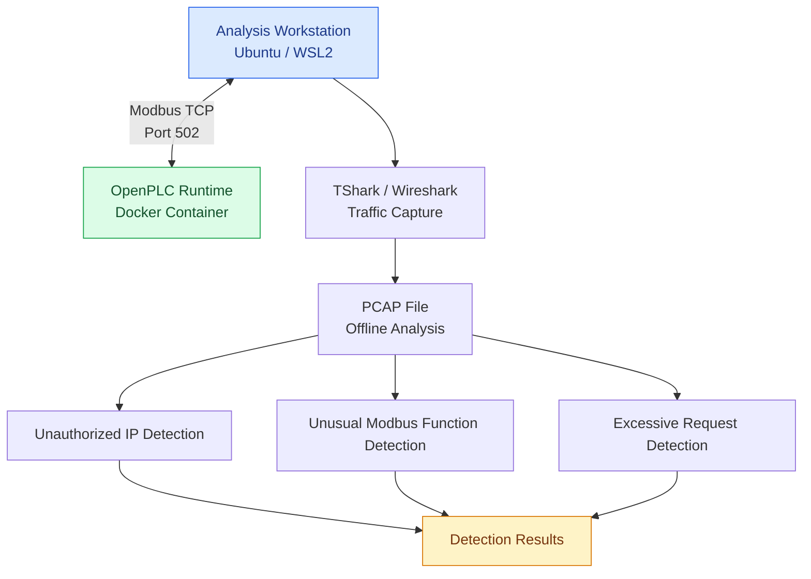

# Industrial Network Security Lab — Architecture

## 1. Overview

This laboratory provides an isolated environment for studying industrial network communications and basic cybersecurity monitoring.

The architecture uses OpenPLC Runtime to simulate a PLC communicating through Modbus TCP. Network traffic is captured and analyzed using TShark and Python.

## 2. Network Architecture

## 3. Main Components

| Component | Role |
|---|---|
| Ubuntu / WSL2 | Analysis workstation |
| Docker | Runtime containerization |
| OpenPLC Runtime | PLC simulation |
| Modbus TCP | Industrial communication protocol |
| TShark / Wireshark | Network traffic capture and inspection |
| Python | Detection scripts |
| Pytest | Automated testing |

## 4. Communication

The simulated PLC communicates using Modbus TCP over port 502.

The laboratory tests the following operations:

- FC1: Read Coils
- FC5: Write Single Coil

Traffic is captured locally and saved in PCAP format for offline analysis.

## 5. Security Monitoring

Three detection mechanisms are implemented:

1. Unauthorized IP detection using an allowlist.
2. Unusual Modbus function detection using an authorized function list.
3. Excessive request detection using a sliding time window.

## 6. Security Scope and Limitations

- The environment is an isolated laboratory.
- The PLC is simulated and no physical industrial equipment is used.
- Traffic analysis is performed offline from PCAP files.
- Detection thresholds and authorized values are manually configured.
- The scripts identify suspicious patterns but do not block network communications.
